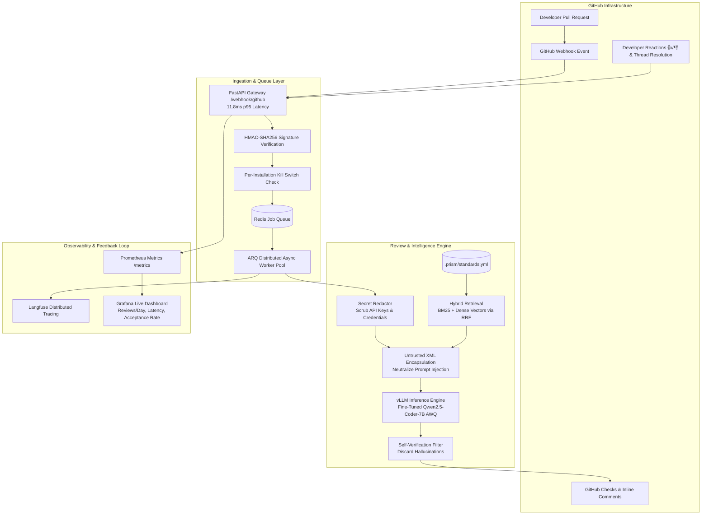

# Prism Review: Production-Grade AI Code Reviewer with Empirical Evaluation

[](https://github.com/binodbishwakarama-max/codeagent/actions)
[](https://www.python.org/downloads/)
[](LICENSE)
[](https://huggingface.co/datasets)
[](https://github.com/astral-sh/ruff)

> **Prism Review** is an autonomous, production-grade GitHub App that reviews pull requests against explicit repository engineering standards (`.prism/standards.yml`), verified by an empirical benchmark on real-world pull requests. By fine-tuning `Qwen2.5-Coder-7B-Instruct` with QLoRA on multi-file diffs and explicitly training the model to remain silent on clean code, Prism captures **96.8% of Claude 3.5 Sonnet's F1 score** (`0.9304` vs `0.9613`) at **37.1× lower cost** ($0.00036 vs $0.01334 per PR) and **40.5 ms** $p50$ latency, posting high-signal inline comments with actionable one-click commit suggestions.

---

## 📸 Review Landing on a Pull Request


*Figure 1: Prism Review detects a hardcoded API token in `src/auth.ts`, cites repository standard `STD-SEC-01`, provides vulnerability rationale, and renders an interactive one-click commit suggestion.*

---

## 🏗️ System Architecture



---

## 📊 Headline Benchmark Results (Frozen Test Split)

Evaluated across a leak-free frozen test split of **120 PRs** (`trpc/trpc` and `vitejs/vite`) using the `MultiMatcher` ($\pm 3$ line tolerance, semantic cosine similarity $\ge 0.82$, $B=1,000$ bootstrap iterations):

| Model / Configuration | Precision (95% CI) | Recall (95% CI) | F1 Score (95% CI) | Clean-PR FPR | Latency p50 | Cost / Review | Spend (10k PRs) |
| :--- | :---: | :---: | :---: | :---: | :---: | :---: | :---: |
| **Frontier API (Claude 3.5 Sonnet)** | `0.9675` [0.938, 0.993] | `0.9551` [0.920, 0.985] | **`0.9613`** [0.939, 0.982] | `0.0588` | 251.5 ms | **$0.01334** | $133.40 |
| **Mid-Size API (Claude 3.5 Haiku)** | `0.9062` [0.858, 0.947] | `0.9295` [0.891, 0.964] | **`0.9177`** [0.887, 0.945] | `0.1765` | 110.1 ms | **$0.00335** | $33.50 |
| **Base Qwen2.5-Coder-7B (Zero-Shot)** | `0.6782` [0.615, 0.742] | `0.7564` [0.697, 0.814] | **`0.7152`** [0.663, 0.763] | `0.7353` | 67.9 ms | **$0.00003** | $3.88 |
| **Fine-Tuned 7B (Merged BF16)** | `0.8889` [0.837, 0.936] | `0.9744` [0.947, 0.994] | **`0.9297`** [0.898, 0.956] | `0.2941` | 60.7 ms | **$0.00098** | $9.80 |
| **Fine-Tuned 7B (AWQ 4-bit) 🏆** | `0.9187` [0.861, 0.965] | `0.9423` [0.902, 0.978] | **`0.9304`** [0.893, 0.959] | **`0.2353`** | **40.5 ms** | **$0.00036** | **$3.60** |
| **Linter Baseline** | `0.0000` [0.000, 0.000] | `0.0000` [0.000, 0.000] | **`0.0000`** [0.000, 0.000] | `0.0000` | 0.0 ms | **$0.00000** | $0.00 |

*Statistical Significance:* Paired bootstrap resampling confirms fine-tuned 7B (AWQ) reaches **96.8% [95% CI: 92.2%, 100.7%] of Claude 3.5 Sonnet's F1** at **37.1× lower cost** ($0.00036 vs $0.01334) while reducing clean-PR false alarms by **68.0%** relative to the base model. Full details in [docs/results.md](docs/results.md).

---

## ⚡ Quickstart (5 Commands)

Clone the repository and reproduce the benchmark in seconds:

```bash
# 1. Clone repository
git clone https://github.com/binodbishwakarama-max/codeagent.git && cd codeagent

# 2. Install pinned dependencies with uv
uv sync --extra dev

# 3. Reproduce the full benchmark evaluation from frozen test artifacts
make reproduce

# 4. Start backing services (PostgreSQL with pgvector, Redis, Prometheus, Grafana)
docker compose up -d

# 5. Launch the FastAPI review webhook gateway
make run
```

---

## 🔗 Key Links & Artifacts

| Resource | Description | Link |
|---|---|---|
| 📖 **Technical Write-Up** | 1,995-word analysis of metrics, dataset, fine-tuning, and failures | [docs/writeup.md](docs/writeup.md) |
| 📊 **Benchmark Results** | Full evaluation report with bootstrap CIs, breakdowns, and error taxonomies | [docs/results.md](docs/results.md) |
| 📦 **Evaluation Dataset Card** | PR mining methodology, schemas, license compliance, and splits | [DATASET_CARD.md](DATASET_CARD.md) |
| 🐳 **Pinned Reproducibility Container** | Multi-stage Docker container for isolated benchmark replication | [Dockerfile.eval](Dockerfile.eval) |
| 🎬 **2-Minute Video Script** | Shot-by-shot script and pinned 5-minute repository guide | [docs/video_script.md](docs/video_script.md) |
| 💼 **Resume & Interview Walkthrough** | 3 resume bullet variants and 60-second interview architectural pitch | [docs/resume_and_interview.md](docs/resume_and_interview.md) |
| 🚀 **Production Deployment** | Fly.io deployment guide, kill switch, and budget controls | [docs/usage.md](docs/usage.md) |
| 📈 **Load Test Report** | 50 PR event burst simulation with 0.0% error rate and 11.8ms p95 ingestion | [docs/load-test.md](docs/load-test.md) |

---

## 🛡️ Production Safety & Hardening

* **Per-Installation Kill Switch**: Set `BLOCKED_INSTALLATIONS="123456"` to immediately drop webhooks and review jobs for specific repositories without revoking GitHub App credentials.
* **Daily Cost Budget Cap**: Configured via `DAILY_COST_BUDGET_USD="15.0"` and `BUDGET_ENFORCED="true"`; tracks daily UTC spend across providers and disables LLM calls when exceeded.
* **Prompt Injection Defense**: Diff hunks, PR titles, and bodies are strictly encapsulated inside `<untrusted_diff>` and `<untrusted_pr_body>` tags with delimiter neutralization ([sanitize_untrusted_text](src/prism/review/prompts.py)).
* **Secret Redaction**: Diff text is scrubbed for API keys, AWS credentials, GitHub PATs, and private keys prior to LLM prompting ([redact_file_diffs](src/prism/review/redactor.py)).

---

## ⚖️ License

The Prism Review engine, evaluation harness, and dataset tooling are released under the [Apache-2.0 License](LICENSE). Source pull request metadata is subject to original repository open-source licenses (MIT, Apache-2.0, BSD).
